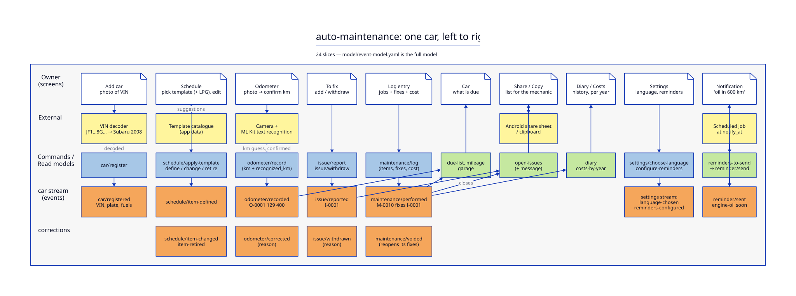

# Developer guide

How Odo & Wrench is designed, built and changed. Agents: also read [AGENTS.md](../AGENTS.md) (rules) and the open
issue files `*-issue.org` in the project root.

## Model first

The behaviour is designed as an **event model** before any code (Event Modeling, Adam Dymitruk; *Understanding
Eventsourcing*, Martin Dilger):

- [model/event-model.yaml](../model/event-model.yaml) — the source of truth: 24 slices, each with Given/When/Then
  (state changes) or Given/Then (read models) scenarios, language-neutral.
- [model/event-model.svg](../model/event-model.svg) — the timeline of one car (rendered from
  [event-model.d2](../model/event-model.d2)).
- [model/review-2026-11-21-first-cut.org](../model/review-2026-11-21-first-cut.org) — decisions D1–D16 and why.
- [docs/slices.md](slices.md) — generated list of slices with their implementation status (`bb docs`).

A slice is exactly one of: **state-change** (screen → command → events), **state-view** (events → read model →
screen), **automation** (read model as a to-do list → processor → command), **translation** (external data → command).
New behaviour is a new slice in the YAML with scenarios, reviewed first; code implements only what the model says. An
approved scenario is the contract — when code and scenario disagree, find out which one is wrong.



## Architecture

```
screen (main.cljd) ──command──▶ app/execute! ──▶ decide (pure) ──events──▶ store (SQLite, append-only)
      ▲                                                             │
      └──────── read model (pure fn of events) ◀── app/!events ◀────┘
```

| Part | Where | Rule |
|---|---|---|
| command handling | `src/auto_maintenance/domain/decide.cljd` | `evolve` folds events into state, `decide` returns events or throws `(ex-info msg {:category "invalid" \| "not-found" \| "conflict"})`; pure, no I/O |
| read models | `src/auto_maintenance/domain/views.cljd` | pure functions `events, params -> data` (`due-list`, `mileage`, `open-issues`, `diary`, `costs-by-year` …) |
| dates | `domain/dates.cljd` | ISO date strings, computed in UTC |
| odometer number picking | `domain/odometer.cljd` | pure: recognised text lines → candidate readings |
| VIN | `domain/vin.cljd` | pure: VIN candidates in recognised text, offline decoding (WMI → make, model year, a few model codes) |
| receipts | `domain/receipt.cljd` | pure: the AI prompt and the parser of the pasted JSON |
| backup format | `domain/backup.cljd`, `domain/json.cljd` | pure: events ⇄ `events.jsonl` |
| event store | `src/auto_maintenance/store.cljd` | one table `events(seq, stream, type, data)`, data as EDN; stream = car id or `settings` |
| app | `src/auto_maintenance/app.cljd` | `!events` (whole log in memory), `execute!` — the only write path |
| adapters | `src/auto_maintenance/photos.cljd` | camera / gallery (image_picker), ML Kit text recognition, photo files |
| reminders | `src/auto_maintenance/reminders.cljd`, `lib/main.dart` | WorkManager job at the configured time: `reminders-to-send` → notification + `reminder/send`; reschedules itself. Its Dart entry point `callbackDispatcher` (needs `@pragma('vm:entry-point')`) is in `lib/main.dart`, which also initialises WorkManager and calls the ClojureDart `main` |
| texts | `src/auto_maintenance/i18n.cljd`, `assets/l10n/app_{en,uk}.arb` | `(t :key {:placeholder v})`; ARB files loaded at start; a test checks that Ukrainian has every key and placeholder |
| templates | `assets/templates/*.json`, listed in `index.json` | schedule templates (D8) with sources per item; reviewed in `model/templates-review-2026-11-23.org`; matched by `views/template-suggestions` |
| backup | `src/auto_maintenance/backup.cljd` | zip of `backup.json` + `events.jsonl` + `photos/`; export via the share sheet, restore via the file picker (replaces everything) |
| screens | `src/auto_maintenance/main.cljd` | render read models, send commands; no business logic |
| slice registry | `src/auto_maintenance/slices.cljd` | slice id → `{:decide …}` or `{:project …}`; drives the model check |

Conventions: events and commands are flat maps with a keyword `:type` (`:odometer/recorded`); ids are assigned once and
never reused (`M-0001` diary entries, `O-0001` readings, `I-0001` issues, slugs for cars and jobs); km are integers;
money is a decimal string plus currency; corrections are new events (`odometer/corrected`, `maintenance/voided`,
`issue/withdrawn`), nothing is edited.

**Hot-reload rule:** Dart hot reload updates function bodies but does not re-run top-level forms. So no
`defmulti`/`defmethod` (dispatch with `case`, see `decide`/`evolve`) and no top-level state that new code depends on.

## Tests — the model check

`bb test` compiles everything and runs:

- [test/auto_maintenance/model_test.cljd](../test/auto_maintenance/model_test.cljd) — reads the YAML and runs every
  scenario of every registered slice against `decide` / the read model (subset match: extra keys allowed, numbers by
  value); prints `model check: N/25 slices implemented`.
- [test/auto_maintenance/odometer_test.cljd](../test/auto_maintenance/odometer_test.cljd) — number picking.

`bb test` always runs in a synced copy under `target/test-copy`. Test compilation writes to that copy,
so you can run the tests while `bb dev` holds the root lock and keep generated test imports out of the app build.

## Implementing a slice

1. The slice and its scenarios are in the YAML and approved.
2. Add the `decide-…` / `evolve-…` functions and their `case` branches (or the read-model function) — pure.
3. Register the slice id in `slices.cljd`; `bb test` until its scenarios pass.
4. Screen + `app` helper; try it on the phone (`bb dev`).
5. `bb docs` (status list and diagram), commit.

## Toolchain

| Tool | Version | Note |
|---|---|---|
| ClojureDart | 0.9.20261002 | [deps.edn](../deps.edn) |
| Flutter | **3.47.9** in `~/sdk/flutter-3.47.9` | 3.50 hangs the compiler (ClojureDart#389); `bb` puts it first on `PATH` |
| Android SDK | platform 36 | `~/Android/Sdk`, `ANDROID_HOME` set by `bb` |
| Clojure CLI, JDK 21, Babashka | | `bb tasks` lists all tasks |

| Task | What it does |
|---|---|
| `bb dev [-d <device>]` | compile, run on the phone, hot reload on save, socket REPL; keys `r` / `R` / `q` + Enter |
| `bb test` | model check + unit tests (no device) |
| `bb docs` | regenerate [docs/slices.md](slices.md) and the diagram |
| `bb release` / `bb install-release` | release APK from a clean clone of HEAD / and install it |
| `bb apk` / `bb install` | debug APK / and install it |
| `bb repl-eval '<form>' [ns]` | evaluate one form in the running app (see REPL below) |

## REPL

`bb dev` opens ClojureDart's socket REPL (beta) on the phone app; `bb repl-eval` (agents) and Emacs `M-x cljd-repl`
(inf-clojure) connect to it. It currently gets stuck after one or two evaluations — causes found so far and the open
case are in [20261122-repl-issue.org](../20261122-repl-issue.org); the rules for using it are in
[AGENTS.md](../AGENTS.md).

## Release builds

`bb release` builds the committed version from a clean clone of HEAD. The pinned Flutter SDK,
R8 rules for ML Kit, and release lint settings are documented in
[20261122-build-workarounds-issue.org](../20261122-build-workarounds-issue.org).
The release APK is signed with the debug key (fine for installing on your own phone; a real signing key is needed for
Google Play).
