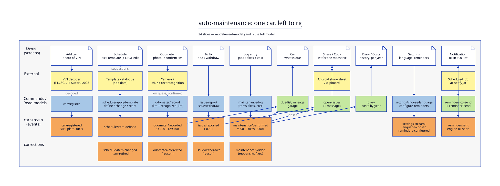

#+TITLE: Event model review — auto-maintenance, first cut
#+DATE: 2026-11-21
#+OPTIONS: toc:nil num:nil ^:nil
#+TODO: TODO COMMENTED | ACCEPTED REJECTED

Model: [[file:event-model.yaml]] (21 slices, 11 event types). Diagram:  (one car, left to
right; the YAML is the full model).

*Approved 2026-11-21.* Nothing is implemented yet; implementation follows slice by slice (=es-slice=). Project setup
(ClojureDart + Flutter skeleton) is the step after approval, not part of this review.

* Changes after the first round (2026-11-21)

From Oleksii's answers to the open questions:
- /General, not two hard-coded cars./ A car is added by scanning its VIN (D10); the decoded make/model/year/engine
  picks a schedule template (D8, rewritten). New slices =template-suggestions=, =apply-schedule-template=;
  =register-car= is now a translation slice with VIN, engine and =decoded=.
- /English by default, Ukrainian available./ New slice =choose-language=; texts in translation files (D11).
- /Reminders are configurable./ New slices =configure-reminders=, =settings=: time of day, days of the week, soon
  window, when to ask for an odometer photo, on/off. Items can carry their own soon window (D5, D9 rewritten).
- /No fuel log, no backups for now./ Both out of scope (D7 rewritten).
- Status =due= dropped: an item is =soon= inside the window and =overdue= once a limit is reached, so a reminder has
  two levels and no fuzzy "due vs overdue" border.

* Changes after the second round (2026-11-21)

D1–D11 accepted. From Oleksii's answers:
- /Costs per year and category/ — new D12, new slice =costs-by-year=, =category= on diary entries with a cost.
- /LPG (butane-propane) filters every 8000 km/ — new D13: =fuels= on the car (=[petrol, lpg]=), an =lpg-system= add-on
  template. Works with the existing schedule slices.
- /Intervals from public sources by VIN, researched later/ — amendment under D8.
- /APK installed by hand; REPL to the phone/ — platform notes below.

* What the app does, in one paragraph

The owner adds a car by photographing its VIN (windscreen plate, door pillar or registration certificate); the app
decodes what it can, the owner completes model, year and engine, and picks a matching schedule template — recurring
jobs with an interval in km and/or months — or defines the jobs by hand. At the car, the owner opens /Capture/,
photographs the plate (picks the car) and the odometer (reads the km); the app pre-fills the number, the owner
confirms it. Optionally the owner logs what was done (scheduled items, free text, cost, receipt photo). The /Car/
screen shows each job as ok / soon / overdue / unknown with a predicted date for km-based items from the average daily
mileage. At the configured time the phone sends one notification per item and level, and asks for a fresh odometer
photo when the last one is too old. English by default, Ukrainian in the settings.

* Screens

1. [@1]  /Garage/ — the cars, last km, the most urgent item of each (=garage=).
2. [@2]  /Add car/ — VIN photo, decoded fields to confirm/complete, plate, name (=register-car=).
3. [@3]  /Car/ — due list of one car (=due-list=, =mileage=); buttons Capture, Log entry, Diary, Schedule.
4. [@4]  /Capture/ — camera: plate, then odometer; confirm/fix the number (=car-by-plate=, =record-odometer=).
5. [@5]  /Log entry/ — date, km (pre-filled from the last capture), items (checkboxes from the schedule), free-text
   work, note, cost, place, photos (=log-maintenance=).
6. [@6]  /Diary/ — history, newest first; void a wrong entry (=diary=, =void-maintenance=).
7. [@7]  /Schedule/ — suggested templates, then items of the car: add, change interval, retire
   (=template-suggestions=, =apply-schedule-template=, =define-/change-/retire-schedule-item=).
8. [@8]  /Mileage/ — readings with photos; correct a misread one (=mileage=, =correct-odometer=).
9. [@9]  /Settings/ — language, reminder time and days, soon window, odometer-photo interval, on/off
   (=settings=, =choose-language=, =configure-reminders=).
10. [@10]  /Notifications/ — Android notifications; tapping opens /Car/ (=reminders-to-send=, =send-reminder=).
11. [@11]  /Costs/ — money per car, year and category (=costs-by-year=).

* Decisions built into the model — approve or change

Each decision is a heading with a state: =TODO= (not reviewed), =COMMENTED= (feedback given, needs another pass),
=ACCEPTED=, =REJECTED=. Feedback goes as text under the heading.

** ACCEPTED D1 One stream per car
CLOSED: [2026-11-21 Sat 20:25]
All events of a car (registration, schedule, readings, diary, reminders) go into the car's stream. The cars share
nothing, so there is no cross-car invariant except "a plate belongs to one car", checked on registration.

*** Amendment 2026-11-21
App-wide preferences (language, reminder settings) are not about a car; they go into one more stream, =settings=.
The per-car rule is unchanged.

** ACCEPTED D2 The owner confirms every reading; the recogniser only suggests
CLOSED: [2026-11-21 Sat 20:25]
=odometer/recorded= holds the confirmed =km= and also =recognized_km= and =confidence=. The app never records a number
the owner did not see. Keeping both numbers shows how often recognition is wrong, which decides whether D3 needs to
change. The photo is kept as evidence (path in the event, file in app storage).

** ACCEPTED D3 Text recognition runs on the phone (Google ML Kit), with Claude vision as a later option
CLOSED: [2026-11-21 Sat 20:25]
- /ML Kit text recognition/ (Flutter package =google_mlkit_text_recognition=): offline, free, fast; odometer digits on
  an LCD can be misread (7/1, 8/0), hence the confirm step in D2. The same recogniser reads the VIN and the plate.
- /Claude vision API/: reads odometers, VINs and plates much better, but needs network, an API key and costs a little
  per photo.
- Recommendation: start with ML Kit; if =recognized_km ≠ km= happens often, add Claude as a second reader behind a
  setting. Both are the same translation slice; only the adapter changes.

** ACCEPTED D4 The car is chosen by a plate photo or a tap; choosing is not an event
CLOSED: [2026-11-21 Sat 20:25]
The plate text is looked up in =car-by-plate= (normalised: spaces removed, Cyrillic look-alikes А В Е І К М Н О Р С Т Х
mapped to Latin, upper case). With a few cars a tap is as fast, so the plate photo is a convenience, not a requirement.
"Recognise which maintenance is needed" is covered by the VIN (which car type → which template, D8, D10) and by the
due list of the chosen car.

** ACCEPTED D5 Due = whichever limit comes first; soon window from the item, else from the settings
CLOSED: [2026-11-21 Sat 20:25]
Defaults 1000 km / 30 days, changed in /Settings/ (=settings/reminders-configured=). An item can carry its own
=soon_km= / =soon_days= (a timing belt needs 3000–5000 km notice to book a garage); templates set these where it
matters. Status =unknown= when an item was never done — the app asks to enter the last time from the service book.

** ACCEPTED D6 The odometer never goes back; history can be entered later
CLOSED: [2026-11-21 Sat 20:25]
A new reading below the current km is refused (=conflict=); a misread is fixed with =odometer/correct= and a reason. A
diary entry may carry an older date and lower km — that is how the history from before the app is entered.

** ACCEPTED D7 Data stays on the phone; no backup and no fuel log in the first version
CLOSED: [2026-11-21 Sat 20:25]
No server, no account. The event log is one append-only SQLite table (package =sqflite=); read models are rebuilt in
memory at start (a few hundred events per car per decade). Because everything is an event log, a backup later is an
export of =events.jsonl= plus photos (to a file or Google Drive, the owner's choice) and needs no model change. Fuel
log (litres, consumption) is out of scope.

** ACCEPTED D8 Schedules come from templates matched to the car; the owner can edit everything
CLOSED: [2026-11-21 Sat 20:25]
A /schedule template/ is data shipped with the app (one file per template: make, model, years, engines, fuel, items
with intervals and soon windows, version). =template-suggestions= matches the car's confirmed make/model/year/engine;
=apply-schedule-template= defines the items in one step, each remembering its template and version. Items the car
already has are kept. After that the owner changes or retires items as before.
- First templates: Subaru Forester SH 2008–2013 petrol (EJ20/EJ25) and Ford Transit 2006–2014 (Mk7) 2.2/2.4 TDCi, from
  the owner's manuals; the values must be checked against the real manuals before they ship.
- Where templates come from later (community, AI-generated from the manual, a public database) is open; the model
  does not depend on it because the command carries the items.

*** Amendment 2026-11-21 (second round)
Intervals are not taken from service books: for each car (by its VIN-decoded type) the template is researched from
public sources (maker's schedules, owner-manual excerpts, specialist forums), with links to the sources kept in the
template file, and reviewed by the owner before use. The research is a separate later task; until then the owner
can define items by hand. Replaces the "from the owner's manuals" bullet above.

** ACCEPTED D9 Reminders at the configured time; one notification per item and level
CLOSED: [2026-11-21 Sat 20:25]
The background job (=workmanager=) runs at =notify_at= on the configured =days=. Levels =soon= and =overdue=; each is
sent once per due point (=due_km= / =due_at=). Logging the job moves the due point, so the next cycle gets its own
reminders. A car without a reading for =stale_days= gets "take an odometer photo". Reminders can be switched off. No
snooze in the first version.

** ACCEPTED D10 A car is identified by its VIN; the decoder fills what it can, the owner confirms
CLOSED: [2026-11-21 Sat 20:25]
- Offline decoding is reliable only for the maker (positions 1–3, WMI: =JF1= Subaru, =WF0= Ford Germany). The model
  year in position 10 is mandatory for North American VINs and used by Japanese makers (Forester =…8G…= → 2008), but
  European VINs such as the Transit's often do not carry it; engine is rarely decodable offline.
- So =car/registered= keeps the confirmed =make/model/year/engine= and, separately, =decoded= — what the decoder said
  (same idea as =recognized_km= in D2).
- Online lookup (NHTSA vPIC, free, no key) is good for US-market cars and weak for European ones; recommendation:
  offline WMI + year table first, online lookup as an optional later adapter.
- Validation: 17 characters A–Z/0–9 without I, O, Q. The check digit (position 9) is not enforced — it is mandatory
  only in North America. One VIN belongs to one car.
- Photo source: the registration certificate (техпаспорт) shows VIN and plate together, so one photo can fill both.

** ACCEPTED D11 English by default; Ukrainian from the settings; texts in translation files
CLOSED: [2026-11-21 Sat 20:25]
No =settings/language-chosen= event means English. Texts (screens, notifications, template item titles) are keys in
one translation file per language (Flutter's ARB files, used from ClojureDart). Adding a language is a new file and an
entry in the supported list — no model change. Data the owner types (notes, place names) is not translated.

** ACCEPTED D12 Costs: category on diary entries, totals per year; fuel and bank import later
CLOSED: [2026-11-21 Sat 20:50]
- A diary entry with a cost carries a =category=: =service= (scheduled work), =repair=, =tyres= (seasonal change,
  new tyres, balancing), =other=. Without a cost no category is needed.
- =costs-by-year=: per car, year and category, per currency (no conversion), voided entries excluded.
- /Later phase, not in this model:/ fuel spend — by scanning fuel receipts (the same recogniser as the odometer, D3)
  or by importing bank transactions (Monobank has a personal API with a token; PrivatBank has one for business
  accounts). Either becomes a translation slice producing =expense/recorded= events with category =fuel=, and
  =costs-by-year= simply adds that category. Insurance and taxes would fit the same way.

** ACCEPTED D13 Fuels are a list on the car; LPG equipment brings its own template
CLOSED: [2026-11-21 Sat 20:50]
- =car/registered= has =fuels= (=[petrol]=, =[diesel]=, =[petrol, lpg]=). LPG is aftermarket, never in the VIN, so the
  owner ticks it when adding the car.
- =template-suggestions= offers the add-on template =lpg-system= to any car with =lpg= (gas filters every 8000 km,
  reducer service), next to the car's own template. Applying both gives one schedule.
- Gap: LPG installed /after/ the car was added has no event yet (=car/fuel-added=). Added when needed.
- The Subaru Forester has the LPG system (answered 2026-11-21); the scenarios use it.

* Open questions

None. All decisions D1–D13 accepted on 2026-11-21; the model is approved for implementation.

* Completeness check

Every screen field traces back to an event attribute, and every event attribute to a command or an external source:

| Screen field                   | Read model            | Event attribute                              | Source                        |
|--------------------------------+-----------------------+----------------------------------------------+-------------------------------|
| car name, plate, VIN, engine   | garage, car-by-plate  | car/registered                               | car/register (VIN decoder)    |
| suggested templates            | template-suggestions  | car/registered make, model, year, engine     | catalogue (app data)          |
| current km, date               | mileage               | odometer/recorded km, at; corrected km       | odometer/record, /correct     |
| km per day, predicted date     | mileage, due-list     | derived from readings                        | —                             |
| item title, intervals, window  | due-list, diary       | schedule/item-defined, item-changed          | schedule/* commands, template |
| last done km/date              | due-list              | maintenance/performed km, at, items          | maintenance/log               |
| cost, place, note, photos      | diary                 | maintenance/performed                        | maintenance/log               |
| costs per year and category    | costs-by-year         | maintenance/performed cost, category, at     | maintenance/log               |
| recognised vs confirmed km     | mileage               | odometer/recorded recognized_km, km          | recogniser + owner            |
| language, reminder settings    | settings              | settings/language-chosen, reminders-configured | settings/* commands         |
| reminder already sent          | reminders-to-send     | reminder/sent level, due_km                  | reminder/send                 |

Gaps, deliberately left out of the first cut:
- =today= in =due-list= and =reminders-to-send= is a parameter (the clock), not an event.
- The template catalogue is static app data, not events; a catalogue update is an app update.
- No event for deleting a car or a photo.

* Platform notes (for the next step, not part of the model)

- ClojureDart compiles Clojure to Dart and uses Flutter widgets and any pub.dev package directly. Needed packages:
  =camera= or =image_picker=, =google_mlkit_text_recognition=, =sqflite=, =flutter_local_notifications=,
  =workmanager= (scheduled background job), =path_provider=, =flutter_localizations= + =intl= (D11).
- Distribution: a debug/release APK installed by hand (=adb install= or copying the file). No Play Store for now.
- REPL on the phone: ClojureDart's Flutter watcher (=clj -M:cljd flutter=) runs the app on the connected phone (USB
  or wireless =adb=) and opens a socket REPL; evaluations are applied through Dart hot reload, so the running app on
  the phone changes without a restart. =cljd.flutter.repl/pick!= selects a widget on the screen, =mount!= replaces it.
  Evaluation can lag in namespaces deep in the dependency graph — one more reason to keep the domain small and pure.
- The domain (decide/evolve per slice, read models) has no Flutter imports, so the scenarios in
  [[file:event-model.yaml]] run as tests without a device.
- This machine (checked 2026-11-21): Clojure CLI 1.12.6, OpenJDK 21, =bb= present; Android SDK at
  [[file:~/Android/Sdk/]] (platform 34, build-tools 34, =adb= in =platform-tools=) but not on =PATH= and no
  =ANDROID_HOME=; *Flutter SDK missing* (needed before setup).

* Review checklist

- [ ] register-car (VIN)
- [ ] garage
- [ ] car-by-plate
- [ ] define-schedule-item
- [ ] change-schedule-item
- [ ] retire-schedule-item
- [ ] template-suggestions
- [ ] apply-schedule-template
- [ ] record-odometer
- [ ] correct-odometer
- [ ] mileage
- [ ] log-maintenance
- [ ] void-maintenance
- [ ] diary
- [ ] costs-by-year
- [ ] due-list
- [ ] choose-language
- [ ] configure-reminders
- [ ] settings
- [ ] reminders-to-send
- [ ] send-reminder
